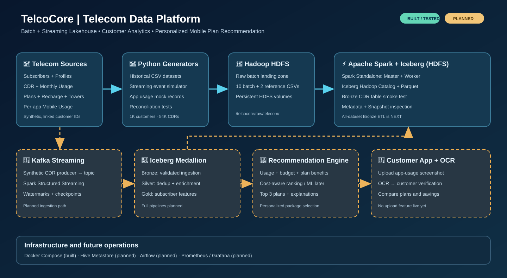

<div align="center">

# 📡 TelcoCore
### End-to-End Telecom Big Data Platform & Personalized Plan Recommendation System

**Batch + Streaming · Hadoop HDFS · Apache Spark · Apache Iceberg · Data Quality · AI/ML Roadmap**

[](https://www.python.org/)
[](https://hadoop.apache.org/)
[](https://spark.apache.org/)
[](https://iceberg.apache.org/)
[](https://www.docker.com/)
[](#implementation-status)

**A portfolio-scale, reproducible telecom lakehouse built around a practical business goal: recommending the most suitable mobile plan based on subscriber usage, budget, behavior, and optional mobile app-usage screenshots.**

[Architecture](#architecture) · [Progress](#implementation-status) · [Datasets](#synthetic-data-model) · [Getting Started](#getting-started) · [Recommendation System](#personalized-plan-recommendation-system-roadmap) · [Roadmap](#development-roadmap)

</div>

---

## Project overview

TelcoCore simulates a telecom operator's end-to-end data ecosystem, connecting **historical records** and **simulated live usage events** to a governed analytics lakehouse. It combines data engineering foundations with a product-oriented **mobile plan recommendation** use case.

The intended final application will let a customer provide or review their monthly voice, SMS, and data consumption, enter their budget, and optionally upload a screenshot of **per-app mobile data usage**. A recommendation engine will rank suitable plans and explain trade-offs, such as expected monthly cost, remaining allowances, and potential savings.

> **Important:** All customer and plan data are **synthetic**, and prices/packages are illustrative—not offers from any real telecom operator. The system is under development; the recommendation API, OCR workflow, Kafka pipeline, and customer-facing app are **planned**, not deployed features.

### Business questions

- What are each subscriber's typical data, voice, and SMS needs?
- Which plan minimizes predicted cost while satisfying usage needs and budget constraints?
- Which customers regularly exceed allowances or pay for unused capacity?
- Which apps/categories (video, social, messaging, etc.) drive mobile data demand?
- How does near-real-time consumption change a subscriber's estimated needs?
- How can the system explain its recommendations transparently?

## Architecture



**Solid blue components in the diagram are implemented/tested; dashed amber components are planned.** The current lakehouse uses **HDFS** for physical storage, not S3 or MinIO.

**Current working path**

```text
Python synthetic generators
        │
        ▼
Local CSV datasets ──► Data quality + reconciliation tests
        │
        ▼
HDFS raw landing (/telcocore/raw/telecom/)
        │
        ▼
Spark standalone cluster ──► Iceberg Hadoop Catalog on HDFS
                                  └─► Bronze smoke-test table
```

**Target end-to-end path**

```text
Historical CSV files ─► HDFS raw ────────────────────────────┐
                                                              │
Live CDR simulator ─► Kafka topics ─► Spark Structured Streaming
                                                              │
                                                              ▼
                                                  Iceberg Bronze tables
                                                              │
                                             Quality + dedup + enrichment
                                                              ▼
                                                  Iceberg Silver tables
                                                              │
                                         Monthly features / plan comparison
                                                              ▼
                                                  Iceberg Gold tables
                                                              │
                                     Recommendation API + customer web app
                                                              ▲
Customer screenshot ─► upload validation ─► OCR ─► user review┘
```

Airflow orchestration, Hive Metastore integration, monitoring, dashboards, and automated deployment are planned follow-on components; they are not represented as completed services.

## Implementation status

Status reflects validated steps in this project, **not a claim of production readiness**.

| Component / milestone | Status | Evidence / scope |
|---|---|---|
| Single `compose.yaml` with Hadoop NameNode + DataNode | ✅ Tested | HDFS report showed one live DataNode; sample upload/read/fsck succeeded |
| Spark Standalone Master + Worker | ✅ Tested | Worker registered; executors ran on standalone cluster |
| Spark reads CDRs from HDFS | ✅ Tested | 3 total / 1 voice record; smoke test passed |
| Apache Iceberg Spark integration | ✅ Tested | Hadoop Catalog on HDFS; Bronze CDR smoke-test table created |
| Iceberg metadata and snapshot inspection | ✅ Tested | Parquet, metadata JSON, manifests, snapshot history inspected |
| Synthetic customer / plan / usage datasets | ✅ Generated | 1,000 subscribers, 54,000 CDR events, 3,000 subscriber-months |
| Per-app mobile usage dataset | ✅ Generated | 30,000 app-usage records; mock upload metadata generated |
| Data-quality + monthly app-usage reconciliation | ✅ Tested | Subscriber/month references and month totals validated |
| Batch CSV upload to HDFS raw landing | ✅ Tested | 10 batch + 2 reference CSV datasets present |
| Reusable Iceberg Bronze ingestion for all 12 files | 🚧 Next | Explicit schema mapping, metadata, repeatable writes |
| Iceberg Silver / Gold pipelines | 📋 Planned | Quality, deduplication, aggregates, recommendation features |
| Kafka event ingestion | 📋 Planned | JSON events from existing simulator |
| Spark Structured Streaming into Iceberg | 📋 Planned | Checkpointing, late events, deduplication |
| Hive Metastore/catalog integration | 📋 Planned | Replace or complement initial Hadoop Catalog |
| Apache Airflow scheduling | 📋 Planned | DAGs and dependency management |
| Monitoring / dashboards | 📋 Planned | Prometheus, Grafana, BI integration |
| OCR-assisted screenshot upload | 📋 Planned | Explicit user confirmation and privacy controls |
| Plan recommendation engine + customer application | 📋 Planned | Cost baseline, later ranking/ML and explanations |

> A three-record Iceberg **smoke test** is not equivalent to the planned all-dataset Bronze pipeline. The previous Time Travel explanation was educational; a separate before/after Time Travel experiment has not yet been verified here.

## Technology stack and rationale

| Tool | Purpose | Why it is used |
|---|---|---|
| **Python** | Synthetic telecom generators and validators | Fast, reproducible dataset creation and tooling |
| **Docker Compose** | Local multi-service stack | One shared configuration, predictable local development |
| **Hadoop HDFS 3.4.1** | Persistent distributed-style file storage | Storage mechanics, permissions, and Hadoop integration |
| **Apache Spark 3.5.9** | Distributed batch / future streaming compute | PySpark SQL, DataFrames, scalable processing |
| **Apache Iceberg 1.10.1** | Transactional lakehouse table format | Snapshots, schema evolution, ACID commits, time travel |
| **Hadoop Catalog** | Initial Iceberg table catalog | Simple HDFS-backed table discovery without a metastore service |
| **Kafka** *(planned)* | Event transport | Durable event streams and replayable ingestion |
| **Hive Metastore** *(planned)* | Shared catalog | Metadata and engine interoperability |
| **Airflow** *(planned)* | Orchestration | Repeatable scheduled dependencies and retries |
| **Prometheus / Grafana** *(planned)* | Monitoring | Operational metrics and observability |
| **Recommendation model / API** *(planned)* | Customer-facing intelligence | Rank and explain mobile plan choices |
| **OCR pipeline** *(planned)* | Screenshot-assisted intake | Extract app usage, with customer verification |

### Current versions

| Component | Version / configuration |
|---|---|
| Hadoop Docker image | `apache/hadoop:3.4.1` |
| Spark Docker image | `apache/spark:3.5.9-java17-python3` |
| Iceberg Spark runtime | `org.apache.iceberg:iceberg-spark-runtime-3.5_2.12:1.10.1` |
| Spark Master address (Compose network) | `spark://spark-master:7077` |
| NameNode HDFS URI | `hdfs://namenode:9000` |
| NameNode UI (host) | `http://localhost:9870` |
| Spark Master UI (host) | `http://localhost:8090` |
| Iceberg Hadoop Catalog warehouse | `hdfs://namenode:9000/telcocore/warehouse` |

## Synthetic data model

All synthetic records use stable IDs to support joins and repeatable test runs. The source data supports subscriber history, budget-aware package selection, usage analytics, and later recommendations.

| Data source | File / table concept | Business purpose |
|---|---|---|
| Subscriber master | `subscribers.csv` | Subscriber, activation, active plan, geography, segment |
| Customer profile | `customer_profiles.csv` | Preferences, budget and personalization fields |
| Mobile plans | `plans.csv` | Available packages, allowances, pricing and overage rules |
| Call/data/SMS records | `cdr_events.csv` | Event-level voice, SMS and mobile data usage |
| Monthly aggregates | `monthly_usage.csv` | Subscriber-month usage, costs and event counts |
| App usage | `app_usage.csv` | Mobile data consumed per app and month |
| Plan history | `subscriber_plan_history.csv` | Previous plan assignments |
| Plan changes | `plan_changes.csv` | Simulated customer plan transitions |
| Recharge transactions | `recharges.csv` | Subscriber account top-ups |
| Cost-based labels | `cost_optimal_plan_labels.csv` | Rule-computed plan choices for offline comparison |
| Screenshot upload mocks | `usage_uploads_mock.csv` | Mock upload metadata; **not actual user images or OCR results** |
| Cell tower reference | `cell_towers.csv` | Network location reference |

### Validated development data volumes

| Measure | Value |
|---|---:|
| Subscribers | **1,000** |
| CDR records | **54,000** |
| Subscriber-month usage records | **3,000** |
| Cost simulation labels | **3,000** |
| Per-app usage records | **30,000** |
| HDFS batch CSV files | **10** |
| HDFS reference CSV files | **2** |

The simulator can be rerun with a fixed seed for reproducible data. New event generation is designed to use existing subscriber IDs, ensuring consistent relationships between batch and streaming sources.

### Relationships

```text
subscribers (subscriber_id) 1 ──── * cdr_events
                            1 ──── * monthly_usage
                            1 ──── * app_usage
                            1 ──── * recharges
                            1 ──── * subscriber_plan_history
plans (plan_id)          1 ──── * subscriber_plan_history
cell_towers (cell_id)   1 ──── * cdr_events (where populated)
```

These are **logical data-contract constraints**, not automatically enforced foreign keys inside Iceberg.

### Critical app usage schema

```csv
subscriber_id,usage_month,period_start,period_end_exclusive,app_name,app_category,mobile_data_mb,source,verification_status
```

This enables app usage breakdowns (for example, video vs social) without double-counting internet consumption in the monthly totals. `period_end_exclusive` means the final date is not included in the reporting window.

## Repository layout

```text
telcocore-data-platform/
├── compose.yaml                     # Shared Docker Compose stack
├── configs/
│   ├── hadoop/                      # HDFS client/server XML
│   ├── spark/
│   ├── kafka/                       # Future integration
│   └── hive/                        # Future integration
├── data/
│   ├── batch/                       # Synthetic historical CSV samples
│   ├── reference/                   # Plans and cell tower data
│   └── samples/                     # Initial CDR smoke-test sample
├── docs/
│   ├── architecture/
│   │   └── telcocore_architecture.svg
│   └── runbooks/
├── governance/
│   ├── contracts/                   # Data schemas / contracts
│   ├── quality/
│   └── lineage/
├── infrastructure/
│   ├── hadoop/
│   ├── spark/
│   ├── iceberg/
│   ├── kafka/
│   ├── hive/
│   └── monitoring/
├── scripts/
│   ├── generate_recommender_data.py
│   ├── generate_app_usage.py
│   ├── stream_cdr.py
│   └── ingest_batch_to_hdfs.sh
├── src/
│   ├── batch/
│   │   ├── hdfs_cdr_smoke_test.py
│   │   ├── iceberg_bronze_smoke_test.py
│   │   └── iceberg_snapshot_inspection.py
│   ├── streaming/                   # Future streaming consumers
│   ├── producers/
│   └── common/
├── tests/
│   ├── integration/
│   │   └── test_app_usage_quality.py
│   └── unit/
├── sql/
│   ├── analytics/
│   └── hive/
└── orchestration/
    └── dags/                        # Planned Airflow DAGs
```

The directory tree describes the intended layout and main files; some planned folders may remain empty or contain placeholders.

## Getting started

### Prerequisites

- Docker Engine and Docker Compose plugin
- WSL2 + Ubuntu (recommended on Windows), or Linux
- Python 3 for local data generation / tests
- A machine with enough memory to run Hadoop and Spark simultaneously (development settings limit the Spark worker to **2 cores / 2 GiB**)

> Use the repository's **existing single `compose.yaml`**. Do not split services into multiple Compose projects or run `docker compose down -v` unless intentionally deleting persistent HDFS volumes.

### 1. Clone the repository

```bash
git clone https://github.com/gharam15/telcocore-end-to-end-data-platform.git
cd telcocore-end-to-end-data-platform
```

If you already have the local working directory, use it instead.

### 2. Start the storage and compute services

```bash
docker compose config --quiet
docker compose up -d namenode datanode spark-master spark-worker
docker compose ps
```

**First-time Hadoop setup:** HDFS storage directories need the correct owner and the NameNode needs an initial format. Formatting an **existing** NameNode can destroy HDFS state. Consult your setup notes before initializing a fresh installation; **never format an already-used NameNode**.

### 3. Generate the datasets

```bash
python3 scripts/generate_recommender_data.py \
  --output data \
  --subscribers 1000 \
  --seed 20261017

python3 scripts/generate_app_usage.py \
  --data-dir data \
  --seed 20261017 \
  --mock-uploads
```

Run the main generator **first**: the app usage generator depends on `data/batch/monthly_usage.csv`.

### 4. Run the data quality gate

```bash
python3 tests/integration/test_app_usage_quality.py
```

Validated output includes:

```text
Monthly usage reconciliation: PASSED
Subscriber relationships: PASSED
Monthly relationships: PASSED
Non-negative app usage: PASSED
TELCOCORE_APP_USAGE_QUALITY_PASSED
```

This includes a reconciliation check comparing each subscriber-month's per-app total (MB) to monthly internet usage (GB converted to MB, allowing the generator's rounding tolerance).

### 5. Ingest synthetic CSV files into HDFS

```bash
bash scripts/ingest_batch_to_hdfs.sh

docker compose exec -T namenode \
  hdfs dfs -ls -h /telcocore/raw/telecom/batch/

docker compose exec -T namenode \
  hdfs dfs -ls -h /telcocore/raw/telecom/reference/
```

Expected layout:

```text
/telcocore/raw/telecom/
├── batch/       # 10 historical CSVs
└── reference/   # 2 reference CSVs
```

The current script overwrites matching development files for convenient reruns. A future production-style ingestion design will create immutable, batch-ID or time-partitioned landing paths and audit manifests.

### 6. Execute the Spark + HDFS smoke test

```bash
docker compose exec -T spark-master \
  /opt/spark/bin/spark-submit \
  --master spark://spark-master:7077 \
  --deploy-mode client \
  --conf spark.driver.host=spark-master \
  --conf spark.driver.bindAddress=0.0.0.0 \
  --conf spark.executor.memory=1g \
  --conf spark.executor.cores=1 \
  --conf spark.hadoop.fs.defaultFS=hdfs://namenode:9000 \
  /opt/spark/jobs/batch/hdfs_cdr_smoke_test.py
```

Validated result:

```text
Total Records: 3
Voice Records: 1
TELCOCORE_SPARK_HDFS_TEST_PASSED
```

### 7. Execute the Iceberg Bronze smoke test

```bash
docker compose exec -T spark-master \
  /opt/spark/bin/spark-submit \
  --master spark://spark-master:7077 \
  --deploy-mode client \
  --packages org.apache.iceberg:iceberg-spark-runtime-3.5_2.12:1.10.1 \
  --conf spark.jars.ivy=/tmp/telcocore-ivy \
  --conf spark.driver.host=spark-master \
  --conf spark.driver.bindAddress=0.0.0.0 \
  --conf spark.executor.memory=1g \
  --conf spark.executor.cores=1 \
  --conf spark.hadoop.fs.defaultFS=hdfs://namenode:9000 \
  --conf spark.sql.extensions=org.apache.iceberg.spark.extensions.IcebergSparkSessionExtensions \
  --conf spark.sql.catalog.telcocore=org.apache.iceberg.spark.SparkCatalog \
  --conf spark.sql.catalog.telcocore.type=hadoop \
  --conf spark.sql.catalog.telcocore.warehouse=hdfs://namenode:9000/telcocore/warehouse \
  /opt/spark/jobs/batch/iceberg_bronze_smoke_test.py
```

Validated result:

```text
TELCOCORE_ICEBERG_BRONZE_TEST_PASSED
```

The test creates the `telcocore.bronze.cdr_events` Iceberg table and inspects the output by reading it back. The smoke-test table is separate from the intended generalized Bronze ingestion pipeline.

### 8. Examine Iceberg snapshots and physical files

```bash
docker compose exec -T namenode \
  hdfs dfs -ls -R /telcocore/warehouse/bronze/cdr_events
```

The validated table included Parquet data, Iceberg metadata JSON versions, a manifest list, a manifest, and one snapshot at inspection time. Additional snapshots may appear after subsequent writes.

## Data quality and engineering principles

- **Referential integrity:** app and usage subscriber IDs refer to the subscriber master; monthly keys agree across inputs.
- **Reconciliation:** monthly sum of per-app mobile usage must match the monthly total within a documented rounding allowance.
- **Type discipline:** planned reusable Bronze loader will use explicit schemas (especially timestamps, monetary amounts and identifiers).
- **Source preservation:** original CSVs land on HDFS separately from Iceberg tables.
- **Idempotency:** smoke-test overwrite behavior is **not** a general production idempotency guarantee; ingestion-run IDs and safe merge strategies are planned.
- **Governance:** planned contracts, schema drift detection, lineage, audit logs and PII controls.
- **Synthetic data boundaries:** mock screenshot rows are not measured from real devices; cost-based recommendation labels are generated by rules, not observed user feedback.

## Personalized plan recommendation system (roadmap)

This is the product feature that motivates the platform's data model.

### Inputs

1. **Subscriber attributes:** profile, segment, budget and current plan.
2. **Network consumption:** monthly voice minutes, SMS and data volume, plus history and seasonality.
3. **Plan catalog:** prices, data/voice/SMS allowances, overage pricing and eligibility.
4. **App-level mobile usage:** video/social/messaging shares derived from synthetic records or a user-confirmed screenshot extraction.
5. **Optional feedback:** eventually, accepted recommendations, plan switches and satisfaction; these are not currently observed training labels.

### Recommendation flow

```text
Subscriber + budget + historical network usage
                      │
App usage breakdown ──┤
                      ▼
      Validate, standardize, build features
                      │
                      ▼
       Calculate expected plan costs
                      │
                      ▼
       Filter eligibility and preferences
                      │
                      ▼
            Rank top 3 packages
                      │
                      ▼
      Explain savings, fit, trade-offs
```

**Stage 1 — Explainable baseline (planned):** rank plans by estimated monthly bill given projected consumption, allowances, excess usage fees, budget and preferences. A cheaper plan is not automatically a better plan if it fails capacity or eligibility requirements.

**Stage 2 — ML ranking (planned):** train/evaluate models only with suitable observed outcomes or a clearly labeled synthetic benchmark. Avoid treating deterministic `cost_optimal_plan_labels.csv` as genuine customer acceptance behavior.

**Stage 3 — Continuous adaptation (planned):** use updated streaming events and rolling usage features to refresh recommendations without double-counting incoming data.

### Screenshot-based mobile app usage (planned)

The customer may upload an Android/iOS screenshot of the device's app-level data usage. The planned intake flow:

1. Accept a supported image and validate format, dimensions and size.
2. Extract app names, usage values and units using OCR.
3. Determine reporting window and **mobile vs Wi‑Fi** usage (never assume a calendar month).
4. Ask the customer to review and correct the extracted figures.
5. Normalize into `app_usage`-compatible records with source/confidence/verification metadata.
6. Compare against network totals where periods are comparable; do not add screenshot usage onto CDR usage as if they were independent consumption.
7. Use the confirmed app mix to personalize explanations and, only where applicable, plan-specific app allowances.

**Privacy design:** minimize collection; avoid retaining original screenshots by default; protect customer identifiers; provide deletion controls and clear consent. No OCR service or upload interface is claimed to be live today.

## Streaming architecture (planned)

A local `stream_cdr.py` simulator can emit JSON-like telecom events at a configurable rate. The next engineering milestone is to publish those events to Kafka and consume them with Spark Structured Streaming.

```text
Synthetic live producer → Kafka topic (CDR events)
                    → Spark Structured Streaming
                    → validation / watermark / deduplication
                    → Iceberg Bronze + Silver
                    → rolling subscriber features
                    → refreshed recommendations
```

Key engineering requirements: event IDs, event-time vs ingestion-time handling, checkpoint storage, offset handling, duplicate-event behavior, backfills, and exactly-once *outcome* verification at the sink rather than assuming it from the infrastructure.

## Development roadmap

| Phase | Deliverables | Status |
|---|---|---|
| 01 — Platform foundation | Single Compose file, HDFS volumes, NameNode/DataNode, Spark cluster | ✅ Tested |
| 02 — Iceberg proof of concept | Bronze test table, snapshot metadata inspection | ✅ Tested |
| 03 — Telecom synthetic data | Plans, customer profiles, CDRs, monthly/app usage, mocks | ✅ Generated |
| 04 — Quality + raw ingestion | Reconciliation validation, 12 CSV files on HDFS | ✅ Tested |
| **05 — Reusable Bronze ETL** | Explicit schemas, source metadata, safe rerun, all 12 datasets | **🚧 NEXT** |
| 06 — Silver | Typed dimensions/facts, dedup, conformed subscriber and plan model | 📋 Planned |
| 07 — Gold | Customer usage features, monthly billing simulation, recommendation inputs | 📋 Planned |
| 08 — Streaming | Kafka producers/topics, Spark streaming writes, checkpoints | 📋 Planned |
| 09 — Governance/orchestration | Hive Catalog, Airflow DAGs, tests, monitoring, runbooks | 📋 Planned |
| 10 — Recommendation MVP | Explainable plan ranking, offline metrics, REST API | 📋 Planned |
| 11 — Customer app + OCR | Screenshot intake, user review, recommendations UI | 📋 Planned |
| 12 — Advanced ML | Feedback pipeline, evaluation and optional ranking models | 📋 Planned |

### The immediate next step

Implement `src/batch/bronze_ingestion.py`. Start with **`subscribers`**, **`customer_profiles`**, **`monthly_usage`**, and **`plans`**. Confirm the **actual CSV headers**, define explicit Spark schemas, then expand to all 12 files. Verify table row counts, typing, metadata columns, snapshots, and repeatable ingest behavior before moving to Silver.

## Troubleshooting lessons learned

| Issue | Root cause | Resolution |
|---|---|---|
| Hadoop XML startup failure | Invalid XML processing instruction | Replaced malformed `core-site.xml` |
| NameNode/DataNode path failures | Container user lacked volume ownership | Corrected named-volume permissions |
| NameNode not formatted on first boot | New HDFS storage had no namespace metadata | Initialized NameNode once; never reformat an existing namespace |
| Spark config did not appear | Container mounts not yet applied | Recreated Spark containers with Hadoop XML and `src` mounts |
| Iceberg namespace failed | HDFS `/telcocore` owned by `hadoop`, no Spark write permission | Created dedicated `/telcocore/warehouse`, owned by `spark` |
| App quality test `KeyError: usage_month` | Monthly CSV uses `month`; app CSV uses `usage_month` | Fixed schema-aware join keys |
| App generation missing monthly file | Generator dependency order | Run recommender generator before app usage generator |
| GitHub push DNS/timeouts | WSL network/DNS interruptions | Diagnosed separately from Git history; retried after network fix |

## Next-stage quality targets

- Unit tests for plan pricing rules and currency/volume conversions.
- Schema validation and required-field checks for all datasets.
- Duplicate detection, referential checks and event-time bounds.
- Bronze row-count comparisons against landed raw CSV files.
- Idempotent reruns and ingestion audit trail.
- Recommendation evaluation: coverage, estimated savings, overage risk, budget fit and explanation accuracy.
- Data privacy tests for screenshot capture and deletion flows.

## Contribution and reproducibility

This is a hands-on learning and engineering portfolio project under active development. Keep configuration in the single Compose file, document significant changes, and validate every new component with a reproducible command or integration test. Do not commit real customer data, passwords, `.env` secrets, HDFS volumes, or temporary Spark checkpoints.

## Author

**Gharam** — Data Engineering / Big Data Portfolio Project  
Repository: [gharam15/telcocore-end-to-end-data-platform](https://github.com/gharam15/telcocore-end-to-end-data-platform)

---

<div align="center"><strong>TelcoCore — from raw telecom events to reliable analytics and explainable mobile plan recommendations.</strong></div>
